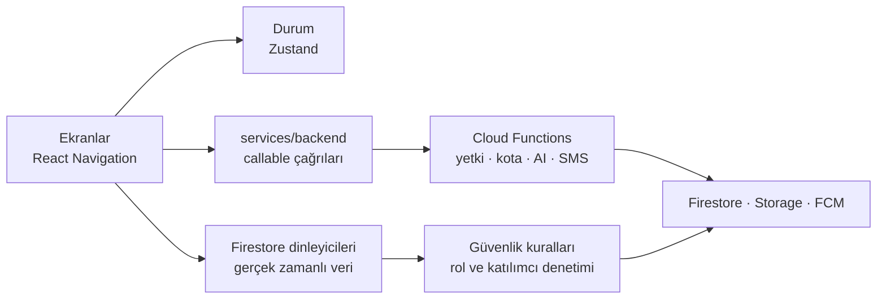

<div align="center">


# Afet Yardım Sistemi

**Yardım çağrısını, gönüllüyü ve koordinatörü aynı anda buluştur.**

<br>

Deprem, sel ve benzeri afetlerde yardım talebini, sahadaki gönüllüyü ve operasyonu yöneten koordinatörü<br>
gerçek zamanlı olarak bir araya getiren, iOS ve Android için çok rollü mobil platform.

<br>

**[Roller](#roller)** &nbsp;·&nbsp; **[Mimari](#mimari)** &nbsp;·&nbsp; **[Güvenlik](#güvenlik-ve-gizlilik)** &nbsp;·&nbsp; **[Testler](#testler)** &nbsp;·&nbsp; **[Kurulum](#kurulum)** &nbsp;·&nbsp; **[Yol haritası](#yol-haritası)**

</div>

<br>

<table>
  <tr>
    <td width="50%" valign="top">
      <h4>🆘&nbsp; Saniyeler içinde çağrı</h4>
      SOS, kategorili yardım talebi, fotoğraf ve sesli mesaj; konum talebe otomatik eklenir.
    </td>
    <td width="50%" valign="top">
      <h4>🧭&nbsp; Doğru gönüllüye doğru görev</h4>
      Görevler aciliyet ve risk skoruna göre sıralanır, gönüllü üstlenir ve durumu adım adım günceller.
    </td>
  </tr>
  <tr>
    <td width="50%" valign="top">
      <h4>🛰️&nbsp; Tek ekrandan operasyon</h4>
      Canlı harita, talep yönetimi, gönüllü onayı, duyuru merkezi ve kriz modu.
    </td>
    <td width="50%" valign="top">
      <h4>🔒&nbsp; Yetki sunucuda denetlenir</h4>
      Rol ve onay istemciden yazılamaz, AI anahtarları uygulamaya girmez, kurallar saldırı testleriyle korunur.
    </td>
  </tr>
</table>

<br>

## Roller

| Rol | Yapabildikleri |
| :-- | :-- |
| **Afetzede** | SOS gönderme · kategorili yardım talebi · fotoğraf ve sesli mesaj · talep takibi · aile ağı ve "Güvendeyim" bildirimi · fener, düdük ve mors kodu araçları · ilk yardım rehberi |
| **Gönüllü** | Başvuru ve koordinatör onayı · görev listesi ve harita · görev üstlenme · yolda, varış ve tamamlandı adımları · göreve giderken canlı konum · kanal üzerinden mesajlaşma |
| **Koordinatör** | Operasyon paneli · talep yönetimi ve gönüllü atama · operasyon haritası · gönüllü onayı ve toplu işlemler · duyuru merkezi · kriz modu · denetim kayıtları |

Koordinatör rolü yalnızca tek kullanımlık davet koduyla, sunucu tarafında verilir.

<details>
<summary><b>Yapay zeka</b></summary>
<br>

| Alan | Nasıl çalışır |
| :-- | :-- |
| **Afet.AI sohbet** | Kısa ve eyleme dönük yanıtlar; hayati risk algılanırsa 112'ye yönlendirir |
| **Talep analizi** | Açıklamadan ya da fotoğraftan kategori ve aciliyet önerir; son karar kullanıcıdadır |
| **Sağlayıcılar** | Gemini ve OpenAI, Cloud Functions üzerinden; kullanıcı başına saatlik kota |
| **Çalışmadığında** | Analiz yapılamazsa kategori uydurulmaz, kullanıcı kendi seçer |

</details>

<br>

## Mimari



| Katman | Sorumluluk |
| :-- | :-- |
| **src/screens** | Role göre ayrılmış ekranlar: `victim`, `volunteer`, `coordinator`, `chat`, `common`, `auth` |
| **src/services** | Callable çağrıları, bildirimler, kullanıcı aynası, SOS kayıtları, telemetri |
| **functions/src** | Talep yaşam döngüsü, gönüllü atama, telefon doğrulama, AI, e-posta, rol claim'leri |
| **firestore.rules · storage.rules** | Sunucu tarafı yetki sınırı; istemciye güvenilmez |

<details>
<summary><b>Teknoloji yığını</b></summary>
<br>

| Alan | Teknoloji |
| :-- | :-- |
| Uygulama | Expo SDK 54, React Native 0.81, TypeScript |
| Gezinme ve durum | React Navigation, Zustand |
| Harita ve konum | react-native-maps, expo-location, Google Places |
| Medya ve bildirim | expo-av, expo-image-picker, expo-notifications |
| Sunucu | Firebase Auth, Firestore, Storage, Cloud Functions (Node 22) |
| Mesajlaşma | Twilio SMS ve WhatsApp, Nodemailer |
| Yapay zeka | Gemini, OpenAI |
| Test | Node test runner, `@firebase/rules-unit-testing`, Firebase Emulator |
| Derleme | EAS Build |

</details>

<details>
<summary><b>Proje yapısı</b></summary>
<br>

```text
.
├── src/
│   ├── screens/          # role göre ekranlar
│   ├── navigation/       # kök gezinme ve rol yönlendirmesi
│   ├── services/         # backend, bildirim, telemetri
│   ├── store/            # Zustand durumu
│   └── firebase/         # istemci yapılandırması (.env)
├── functions/src/        # Cloud Functions ve birim testleri
├── tests/rules/          # güvenlik kuralı testleri
├── firestore.rules       # veritabanı yetkileri
├── storage.rules         # dosya yetkileri ve boyut sınırları
└── docs/                 # gizlilik, kullanım koşulları, kontrol listeleri
```

</details>

<br>

## Güvenlik ve gizlilik

- **Rol yükseltme kapalı:** kullanıcı kendine koordinatör rolü veremez, gönüllü kendini onaylayamaz.
- **Veri yalnızca ilgilisine açık:** talepler sahibine, atanan gönüllüye, onaylı gönüllülere ve koordinatöre; sohbetler yalnızca katılımcılara görünür.
- **Sırlar sunucuda:** AI, SMS ve e-posta anahtarları Secret Manager'da durur, uygulama paketine girmez.
- **Kişisel veri maskeli:** TC, telefon ve e-posta ham olarak saklanmaz; özet ve maskeli hâlleri tutulur.
- **Kötüye kullanım sınırı:** e-posta, SMS, davet kodu ve AI çağrılarında kota; SMS kodları tuzlu HMAC ile saklanır ve istemciye kapalıdır.
- **Dosya sınırları:** yüklemelerde sahiplik, tür ve boyut denetimi vardır.

Gizlilik politikası: [docs/privacy-policy.md](docs/privacy-policy.md)

<br>

## Testler

| Paket | Kapsam |
| :-- | :-- |
| `tests/rules` | 22 güvenlik testi: rol yükseltme, davet kodu sızıntısı, talep ele geçirme, yabancının sohbet okuması, dosya yetkileri |
| `functions/src` | 13 birim testi: talep durum geçişleri, risk algılama, oturum denetimi |

```bash
npm run test:rules        # Firebase Emulator gerekir (Java)
cd functions && npm test
```

<br>

## Kurulum

```bash
npm install && (cd functions && npm install)
cp .env.example .env      # Firebase ve Places değerlerini doldur
npx expo start
```

Sunucu tarafı:

```bash
firebase functions:secrets:set GEMINI_API_KEY
firebase functions:secrets:set OPENAI_API_KEY
firebase deploy --only firestore:rules,storage,functions
```

<br>

## Yol haritası

- [x] Üç rollü gerçek zamanlı akış ve operasyon paneli
- [x] Sunucu tarafı yetki, kota ve güvenlik kuralı testleri
- [x] AI çağrılarının sunucuya taşınması
- [ ] Places çağrılarının da sunucuya taşınması
- [ ] App Check ve Expo SDK yükseltmesi
- [ ] Fiziksel cihaz testi ve saha denemesi
- [ ] Google Play ve App Store yayını

<br>

## Lisans

Tüm hakları saklıdır. Kod yalnızca incelenmek üzere yayımlanmıştır; izin olmadan kullanılamaz, kopyalanamaz ya da yayımlanamaz. Ayrıntılar: [LICENSE](LICENSE)
